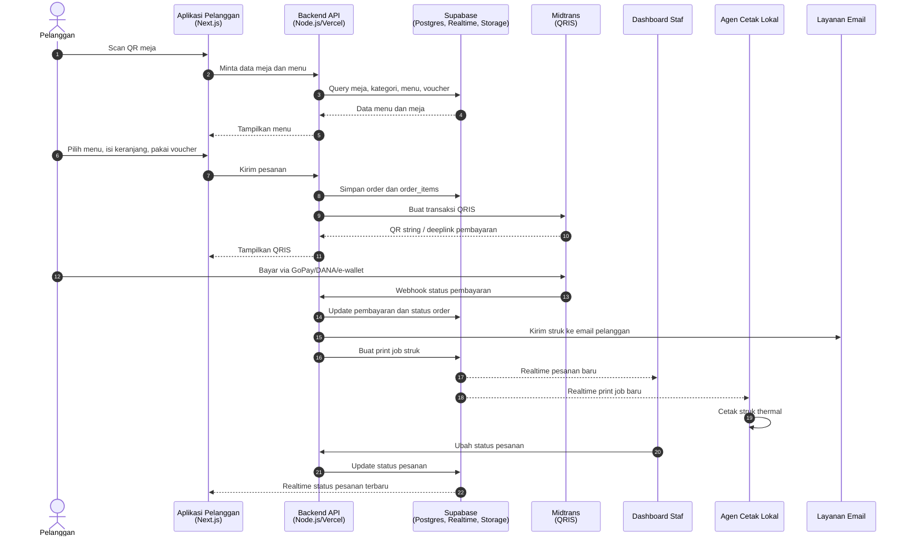
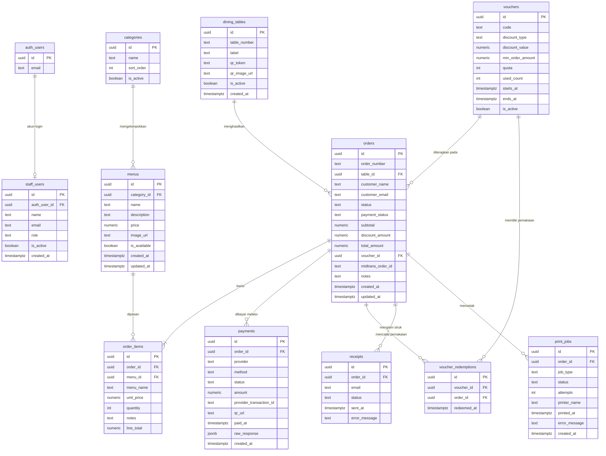

# PRD — Project Requirements Document

## 1. Overview

Saat ini proses pemesanan masih dilakukan melalui kasir. Staf kasir harus menginput pesanan secara manual, dan bila yang bertugas adalah anak magang atau staf baru, proses input bisa lambat sehingga antrian pelanggan menumpuk. Pelanggan juga harus menunggu giliran untuk memesan dan membayar.

Aplikasi ini adalah sistem POS restoran berbasis QR Code Self Order. Pelanggan memindai QR di meja, melihat menu, memesan sendiri dari ponsel, dan membayar melalui QRIS. Pesanan langsung masuk ke antrian staf, struk dapat dikirim ke email dan dicetak di printer thermal, sementara pemilik dapat memantau penjualan lewat dashboard analytics.

Tujuan utama:
- Menghilangkan antrian kasir untuk pemesanan dan pembayaran.
- Mempercepat pesanan masuk ke dapur/antrian staf.
- Mengurangi kesalahan input pesanan manual.
- Memberi pemilik restoran visibilitas atas penjualan dan menu terlaris.
- Menyediakan pengelolaan menu, meja, QR, voucher, dan akun staf dari satu dashboard.

## 2. Requirements

### Kebutuhan Fungsional
- Pelanggan dapat memindai QR unik per meja untuk membuka menu restoran.
- Pelanggan dapat melihat menu berdasarkan kategori, foto, harga, dan status ketersediaan.
- Pelanggan dapat menambahkan menu ke keranjang, mengubah jumlah, dan memberi catatan.
- Pelanggan dapat memasukkan kode voucher dan melihat potongan harga sebelum mengirim pesanan.
- Pelanggan dapat mengirim pesanan sekali tekan agar masuk ke antrian pesanan.
- Pelanggan dapat membayar melalui QRIS menggunakan GoPay, DANA, atau dompet digital lain yang didukung Midtrans.
- Status pembayaran diperbarui otomatis melalui webhook payment gateway.
- Pelanggan menerima bukti pembayaran dan struk digital melalui email.
- Struk pesanan dapat dicetak otomatis di printer thermal kasir/dapur.
- Pelanggan dapat membuka kembali struk dari ponsel.
- Staf dapat melihat daftar pesanan masuk secara real-time, mencari pesanan, dan mengubah status pesanan.
- Admin dapat menambah/mengubah menu, kategori, harga, foto, dan status ketersediaan.
- Admin dapat mengatur daftar meja, membuat QR unik per meja, dan mengunduh QR untuk dicetak.
- Admin dapat membuat voucher, mengatur masa berlaku, kuota, dan nominal potongan.
- Admin dapat melihat ringkasan penjualan harian, menu terlaris, dan filter periode.
- Pemilik dapat mengelola akun staf serta mengatur peran dan hak akses.

### Kebutuhan Non-Fungsional
- Antarmuka pelanggan harus mobile-first dan mudah digunakan tanpa pelatihan.
- Dashboard staf harus responsif dan menampilkan pesanan baru secara real-time.
- Pembayaran harus aman dan tidak menyimpan data sensitif kartu/e-wallet.
- Sistem harus memiliki kontrol akses berbasis peran: pemilik, kasir, dan staf dapur.
- Data pelanggan dan transaksi harus dilindungi dengan Row Level Security di Supabase.
- Proses cetak struk harus memiliki mekanisme percobaan ulang bila printer gagal.
- Aplikasi harus dapat berjalan di Vercel dan terhubung ke Supabase.
- Sistem dirancang untuk satu restoran/outlet per instalasi pada versi awal.

### Di Luar Scope
- Membership pelanggan.
- Stock ingredients tracking / manajemen stok bahan baku.
- Multi-outlet lanjutan.
- Refund otomatis di luar mekanisme payment gateway.
- Aplikasi native Android/iOS.

## 3. Core Features

### Fase 1 — Pesan Mandiri via QR

- **Pesan Mandiri via QR** — Pelanggan memindai QR di meja, memilih menu, dan mengirim pesanan sendiri tanpa lewat kasir.
  - **Scan QR Meja** — Pindai kode QR di meja untuk langsung membuka menu restoran dari ponsel.
  - **Jelajah Daftar Menu** — Lihat menu lengkap dengan foto, harga, dan kategori agar mudah memilih.
  - **Keranjang Pesanan** — Kumpulkan pilihan menu, ubah jumlah, dan tambahkan catatan sebelum dikirim.
  - **Kirim ke Dapur** — Kirim pesanan sekali tekan agar langsung masuk ke antrian pesanan.

### Fase 2 — Pembayaran dan Struk

- **Bayar Pakai QRIS** — Pelanggan membayar pesanan langsung dari ponsel lewat QRIS tanpa antre di kasir.
  - **Pilih Metode Pembayaran** — Tentukan cara bayar lewat QRIS, GoPay, DANA, atau dompet digital lain.
  - **Tampilkan Kode QRIS** — Tampilkan kode QR pembayaran yang bisa dipindai aplikasi e-wallet pelanggan.
  - **Konfirmasi Otomatis** — Status pembayaran diperbarui sendiri tanpa perlu konfirmasi manual ke kasir.
  - **Bukti Pembayaran** — Pelanggan menerima bukti transaksi digital setelah pembayaran berhasil.

- **Struk Pesanan** — Struk pesanan dikirim ke email pelanggan dan bisa dibuka di ponsel. Cetak thermal masih WIP: baru berupa alert/popup, dikerjakan di fase terakhir.
  - **Kirim Struk ke Email** — Struk digital otomatis dikirim ke email pelanggan setelah pembayaran selesai.
  - **Cetak Struk Thermal (WIP)** — Fitur minor yang dikerjakan terakhir. Untuk sekarang hanya menampilkan alert/popup bahwa cetak thermal masih WIP — tidak ada pencetakan ke printer nyata.
  - **Lihat Struk di Ponsel** — Pelanggan bisa membuka ulang struk kapan saja dari ponselnya.

### Fase 3 — Operasional Restoran

- **Antrian Pesanan** — Staf melihat semua pesanan masuk secara langsung dan memperbarui statusnya.
  - **Daftar Pesanan Masuk** — Semua pesanan baru tampil berurutan lengkap dengan nomor meja dan detail menu.
  - **Status Pesanan Otomatis** — Status pesanan berpindah otomatis tanpa input staf, sehingga antrian tetap murni informatif.
  - **Notifikasi Pesanan Baru** — Pemberitahuan muncul setiap ada pesanan baru agar tidak terlewat.
  - **Cari Pesanan** — Temukan pesanan tertentu dengan cepat berdasarkan nomor meja atau nama pemesan, memakai debounce dan rate limit.

- **Kelola Menu & Meja** — Admin mengatur daftar menu, harga, meja, dan kode QR dari satu tempat.
  - **Tambah & Ubah Menu** — Buat menu baru beserta foto, deskripsi, dan harganya.
  - **Atur Kategori & Ketersediaan** — Kelompokkan menu dan tandai habis agar tidak bisa dipesan pelanggan.
  - **Daftar Meja** — Atur nomor dan jumlah meja yang tersedia di restoran.
  - **Buat & Unduh QR Meja** — Buat kode QR unik untuk tiap meja lalu unduh untuk dicetak.

- **Voucher & Promo** — Admin membuat voucher diskon yang bisa dipakai pelanggan saat memesan.
  - **Buat Voucher** — Tentukan kode, besar potongan, dan kuota pemakaian sebuah voucher.
  - **Atur Masa Berlaku** — Tetapkan tanggal mulai dan berakhirnya sebuah promo.
  - **Pakai Voucher saat Pesan** — Pelanggan memasukkan kode voucher dan potongan harga langsung terlihat.

### Fase 4 — Analytics dan Akun

- **Grafik Penjualan** — Admin melihat tren penjualan dan menu terlaris lewat grafik sederhana.
  - **Ringkasan Penjualan Harian** — Lihat total omzet dan jumlah pesanan pada hari itu.
  - **Menu Terlaris** — Ketahui menu yang paling sering dipesan pelanggan.
  - **Filter Periode** — Pilih rentang hari atau bulan untuk melihat laporan penjualan.

- **Akun & Akses Staf** — Pemilik mengatur akun staf dan siapa saja yang boleh membuka dashboard.
  - **Masuk & Keluar Akun** — Staf masuk dengan email dan kata sandi untuk membuka dashboard.
  - **Peran & Hak Akses** — Bedakan wewenang pemilik, kasir, dan staf dapur.
  - **Kelola Akun Staf** — Tambah atau nonaktifkan akun staf yang bertugas.

## 4. User Flow

### Alur Pelanggan
1. Pelanggan duduk di meja dan memindai QR meja.
2. Aplikasi membuka menu restoran sesuai meja tersebut.
3. Pelanggan menjelajah menu berdasarkan kategori, melihat foto, harga, dan ketersediaan.
4. Pelanggan menambahkan menu ke keranjang, mengubah jumlah, dan menulis catatan bila perlu.
5. Pelanggan memasukkan kode voucher bila tersedia dan melihat potongan harga.
6. Pelanggan mengisi nama dan email, lalu mengirim pesanan.
7. Pesanan tercatat dengan status awal “Menunggu Pembayaran”.
8. Pelanggan memilih metode pembayaran QRIS, lalu memindai/membuka QR pembayaran di aplikasi e-wallet.
9. Setelah pembayaran berhasil, status pesanan otomatis berubah menjadi “Dibayar” dan masuk ke antrian staf/dapur.
10. Struk dikirim ke email pelanggan dan dicetak di printer thermal.
11. Pelanggan dapat melihat status pesanan dan membuka kembali struk dari ponsel.

Catatan fase: pada Fase 1 sebelum pembayaran QRIS aktif, pesanan dapat langsung masuk antrian setelah dikirim. Pada versi final, pesanan masuk antrian dapur setelah pembayaran berhasil.

### Alur Staf
1. Staf masuk ke dashboard menggunakan email dan kata sandi.
2. Dashboard menampilkan pesanan baru secara real-time beserta nomor meja dan detail menu.
3. Staf menerima notifikasi saat ada pesanan baru.
4. Staf mencari pesanan tertentu bila diperlukan.
5. Staf mengubah status pesanan: “Sedang Dibuat”, “Siap Disajikan”, atau “Selesai”.
6. Printer thermal mencetak struk pesanan secara otomatis; bila gagal, sistem mencoba ulang.

### Alur Admin/Pemilik
1. Pemilik masuk ke dashboard.
2. Mengatur menu, kategori, harga, foto, dan status ketersediaan.
3. Mengatur daftar meja dan mengunduh QR unik untuk setiap meja.
4. Membuat voucher, kuota, dan masa berlaku promo.
5. Memantau grafik penjualan harian, menu terlaris, dan filter periode.
6. Menambah, menonaktifkan, dan mengatur peran akun staf.

## 5. Architecture

Sistem terdiri dari:
- **Aplikasi pelanggan & dashboard staf/admin**: Next.js yang di-deploy di Vercel.
- **Backend API**: Node.js melalui Next.js Route Handlers di Vercel.
- **Database, Auth, Realtime, dan Storage**: Supabase.
- **Payment gateway**: Midtrans untuk QRIS dan e-wallet.
- **Email service**: pengirim struk digital, misalnya Resend.
- **Agen cetak lokal**: layanan Node.js kecil di restoran yang menerima print job dari Supabase Realtime lalu mengirim perintah ke printer thermal via USB/LAN.

Alur utama:
1. Pelanggan memindai QR meja.
2. Aplikasi mengambil data meja, menu, kategori, dan voucher dari Supabase.
3. Saat pesanan dikirim, backend menyimpan order dan order_items.
4. Backend membuat transaksi QRIS ke Midtrans.
5. Midtrans mengirim webhook status pembayaran ke backend.
6. Backend memperbarui status pembayaran, membuat print job, dan memicu email struk.
7. Supabase Realtime mengirim perubahan pesanan ke dashboard staf dan agen cetak.
8. Staf memperbarui status pesanan, dan perubahan status tampil kembali di ponsel pelanggan.

## 6. Database Schema

Semua tabel menggunakan UUID sebagai primary key dan `timestamptz` untuk waktu. Supabase Auth menangani login staf melalui `auth.users`, sedangkan profil dan peran disimpan di `staff_users`. Akses dashboard dilindungi Row Level Security berdasarkan peran.

### Tabel Utama

**staff_users**
- `id` uuid, primary key.
- `auth_user_id` uuid, referensi ke `auth.users`.
- `name` text, nama staf.
- `email` text, email login.
- `role` text, peran: `owner`, `cashier`, `kitchen`.
- `is_active` boolean, status akun.
- `created_at` timestamptz, waktu dibuat.

**dining_tables**
- `id` uuid, primary key.
- `table_number` text, nomor meja unik.
- `label` text, nama/label meja.
- `qr_token` text, token unik untuk QR meja.
- `qr_image_url` text, lokasi gambar QR.
- `is_active` boolean, status meja aktif.
- `created_at` timestamptz, waktu dibuat.

**categories**
- `id` uuid, primary key.
- `name` text, nama kategori.
- `sort_order` int, urutan tampil.
- `is_active` boolean, status kategori.

**menus**
- `id` uuid, primary key.
- `category_id` uuid, referensi ke `categories`.
- `name` text, nama menu.
- `description` text, deskripsi menu.
- `price` numeric, harga menu.
- `image_url` text, foto menu.
- `is_available` boolean, status tersedia/habis.
- `created_at` timestamptz, waktu dibuat.
- `updated_at` timestamptz, waktu diperbarui.

**vouchers**
- `id` uuid, primary key.
- `code` text, kode voucher unik.
- `discount_type` text, `percent` atau `fixed`.
- `discount_value` numeric, besar potongan.
- `min_order_amount` numeric, minimum belanja.
- `quota` int, kuota pemakaian.
- `used_count` int, jumlah sudah dipakai.
- `starts_at` timestamptz, mulai berlaku.
- `ends_at` timestamptz, berakhir.
- `is_active` boolean, status voucher.

**orders**
- `id` uuid, primary key.
- `order_number` text, nomor pesanan unik.
- `table_id` uuid, referensi ke `dining_tables`.
- `customer_name` text, nama pelanggan.
- `customer_email` text, email pelanggan.
- `status` text, status pesanan: `pending_payment`, `paid`, `queued`, `preparing`, `ready`, `completed`, `cancelled`.
- `payment_status` text, status pembayaran: `pending`, `paid`, `failed`, `expired`, `refunded`.
- `subtotal` numeric, total sebelum diskon.
- `discount_amount` numeric, total diskon.
- `total_amount` numeric, total akhir.
- `voucher_id` uuid, referensi ke `vouchers` bila memakai voucher.
- `midtrans_order_id` text, ID transaksi di Midtrans.
- `notes` text, catatan pesanan.
- `created_at` timestamptz, waktu pesanan dibuat.
- `updated_at` timestamptz, waktu pesanan diperbarui.

**order_items**
- `id` uuid, primary key.
- `order_id` uuid, referensi ke `orders`.
- `menu_id` uuid, referensi ke `menus`.
- `menu_name` text, nama menu saat dipesan.
- `unit_price` numeric, harga satuan saat dipesan.
- `quantity` int, jumlah pesanan.
- `notes` text, catatan per item.
- `line_total` numeric, total per item.

**payments**
- `id` uuid, primary key.
- `order_id` uuid, referensi ke `orders`.
- `provider` text, default `midtrans`.
- `method` text, metode: `qris`, `gopay`, `dana`, `shopeepay`, dll.
- `status` text, status pembayaran.
- `amount` numeric, nominal dibayar.
- `provider_transaction_id` text, ID transaksi dari Midtrans.
- `qr_url` text, URL/string QR pembayaran.
- `paid_at` timestamptz, waktu pembayaran berhasil.
- `raw_response` jsonb, respons mentah payment gateway.
- `created_at` timestamptz, waktu dibuat.

**voucher_redemptions**
- `id` uuid, primary key.
- `voucher_id` uuid, referensi ke `vouchers`.
- `order_id` uuid, referensi ke `orders`.
- `redeemed_at` timestamptz, waktu voucher dipakai.

**receipts**
- `id` uuid, primary key.
- `order_id` uuid, referensi ke `orders`.
- `email` text, email tujuan struk.
- `status` text, status pengiriman: `pending`, `sent`, `failed`.
- `sent_at` timestamptz, waktu terkirim.
- `error_message` text, pesan error bila gagal.

**print_jobs**
- `id` uuid, primary key.
- `order_id` uuid, referensi ke `orders`.
- `job_type` text, jenis cetak: `receipt` atau `kitchen`.
- `status` text, status cetak: `pending`, `printed`, `failed`.
- `attempts` int, jumlah percobaan cetak.
- `printer_name` text, nama printer tujuan.
- `printed_at` timestamptz, waktu berhasil dicetak.
- `error_message` text, pesan error bila gagal.
- `created_at` timestamptz, waktu print job dibuat.

## 7. Tech Stack

- **Frontend**: Next.js dengan App Router, React, Tailwind CSS, dan shadcn/ui.
- **Backend**: Node.js melalui Next.js Route Handlers/API Routes di Vercel.
- **Database**: Supabase Postgres.
- **Authentication**: Supabase Auth dengan profil peran di tabel `staff_users`.
- **Realtime**: Supabase Realtime untuk pesanan baru, perubahan status, dan print job.
- **Storage**: Supabase Storage untuk foto menu dan gambar QR meja.
- **Payment Gateway**: Midtrans untuk QRIS, GoPay, DANA, dan metode e-wallet lain yang didukung.
- **Email**: Resend atau layanan email transaksional sejenis untuk mengirim struk digital.
- **Cetak Thermal**: Agen cetak Node.js lokal menggunakan library ESC/POS seperti `node-thermal-printer`, terhubung ke printer thermal via USB/LAN.
- **QR Code**: Library `qrcode` untuk membuat QR unik per meja.
- **Chart/Analytics**: Recharts untuk grafik penjualan dan menu terlaris.
- **Validasi**: Zod untuk validasi input form dan API.
- **Deployment**: Vercel untuk aplikasi Next.js, Supabase Cloud untuk database dan layanan pendukung, serta agen cetak lokal di restoran.